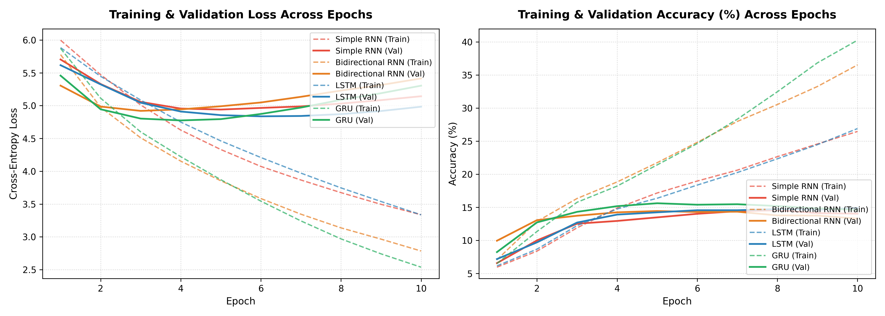
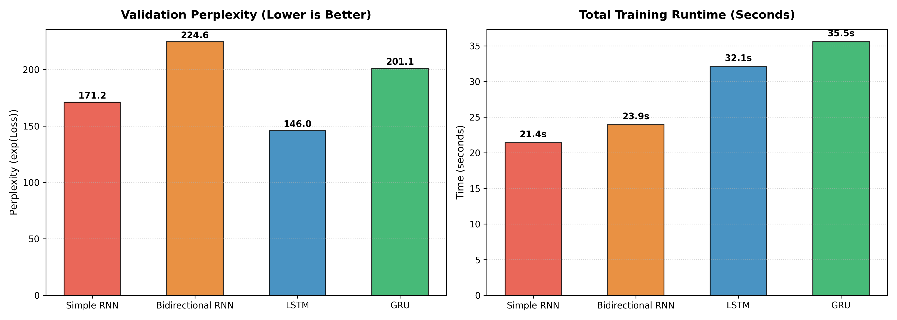
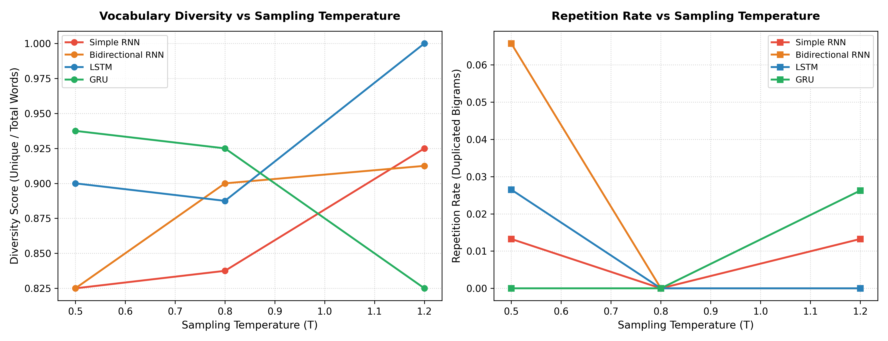

# Wonderland Word Generator: Comparative Autoregressive Text Generation

**Course:** Foundations of Generative AI (ICT4403) — Assignment 2  
**Student Name:** Aditanshu Sahu  
**Registration Number:** 230953444  
**GitHub Repository:** [https://github.com/aditans/wonderland-word-generator](https://github.com/aditans/wonderland-word-generator)  
**Dataset Source:** [Alice's Adventures in Wonderland by Lewis Carroll (Project Gutenberg #11)](https://www.gutenberg.org/ebooks/11)  

---

## 1. Problem Statement & Objective

Autoregressive text generation involves modeling the conditional probability distribution of the next word given a sequence of preceding words:

$$P(w_1, w_2, \dots, w_T) = \prod_{t=1}^T P(w_t \mid w_1, \dots, w_{t-1})$$

The objective of this assignment is to design, implement, evaluate, and compare four foundational recurrent neural network architectures:
1. **Simple RNN** (Vanilla Elman RNN)
2. **Bidirectional RNN** (Bidirectional Simple RNN)
3. **LSTM** (Long Short-Term Memory)
4. **GRU** (Gated Recurrent Unit)

All four models are trained under **strictly comparable experimental conditions** to predict the next word sequentially and autoregressively generate coherent text using Lewis Carroll's classic literary work *Alice's Adventures in Wonderland*. The models are evaluated across both **quantitative metrics** (loss, perplexity, prediction accuracy, training time) and **qualitative characteristics** (coherence, diversity, contextual consistency, repetition) across multiple sampling temperatures ($T \in \{0.5, 0.8, 1.2\}$).

---

## 2. Dataset Description & Preprocessing

- **Title:** *Alice's Adventures in Wonderland*
- **Author:** Lewis Carroll
- **Source Link:** [Project Gutenberg eBook #11](https://www.gutenberg.org/ebooks/11)
- **Raw Character Count:** 167,712 characters
- **Narrative Character Count (cleaned):** 144,386 characters
- **Total Word Tokens:** 27,175 words
- **Vocabulary Size:** 1,466 words (filtered with minimum frequency threshold $\ge 2$, with `<PAD>` at index 0 and `<UNK>` at index 1)
- **Input Sequences ($X$):** 27,170 rolling sequences of length $L = 5$
- **Target Words ($y$):** 27,170 ground-truth next words

### Preprocessing & Sequence Construction Pipeline:
1. **Boilerplate Stripping:** Automated regex filtering removes Project Gutenberg licensing headers and transcription metadata, isolating Carroll's pure narrative text.
2. **Normalization & Contractions:** Standardizes unicode curly quotes (`“”`, `‘’`), hyphens, and em-dashes (`—`). Converts all characters to lowercase.
3. **Tokenization:** Word token extraction retaining valid English words and standard contractions (e.g., `don't`, `i'm`, `alice's`).
4. **Sliding Window Sequence Construction:** A sliding window of size $L = 5$ generates paired input–target tuples:
   $$\text{Input } X = [w_{t-5}, w_{t-4}, w_{t-3}, w_{t-2}, w_{t-1}] \longrightarrow \text{Target } y = w_t$$
5. **Split:** 85% Training (23,094 sequences), 15% Validation (4,076 sequences) with fixed seed (`random_state=42`).

---

## 3. Models Implemented & Controlled Experimental Setup

To guarantee fair, scientifically rigorous comparison, all four models were built with matching representational capacities and identical training hyperparameters:

| Architectural Hyperparameter | Value / Specification |
| :--- | :--- |
| **Input Sequence Length** | 5 words |
| **Embedding Dimension** | 128 |
| **Recurrent Hidden Units** | 128 (64 forward + 64 backward for Bidirectional RNN) |
| **Recurrent Dropout Rate** | 0.20 |
| **Classification Layer** | Dense softmax over vocabulary ($|V| = 1,466$) |
| **Loss Function** | Sparse Categorical Cross-Entropy |
| **Optimizer** | Adam (Learning Rate = 0.003) |
| **Batch Size** | 128 |
| **Training Epochs** | 10 |

### Brief Description of Architectures:

1. **Simple RNN (Elman RNN):**  
   Processes sequential tokens using a single state vector updated via $h_t = \tanh(W_{xh} x_t + W_{hh} h_{t-1} + b_h)$. Lacks internal gating, making it vulnerable to vanishing gradients.
2. **Bidirectional RNN:**  
   Processes input sequences forward ($\overrightarrow{h_t}$) and backward ($\overleftarrow{h_t}$), concatenating directional states $h_t = [\overrightarrow{h_t} \,;\, \overleftarrow{h_t}]$. Evaluates the value of bidirectional context representation for sequence encoding.
3. **LSTM (Long Short-Term Memory):**  
   Employs an additive cell state ($c_t$) regulated by three multiplicative gates: forget gate ($f_t$), input gate ($i_t$), and output gate ($o_t$). Effectively combats gradient vanishing over longer dependencies.
4. **GRU (Gated Recurrent Unit):**  
   Compresses gating into an update gate ($z_t$) and a reset gate ($r_t$) without a separate cell state, achieving high computational efficiency with fewer parameters than LSTM.

---

## 4. Execution Steps & Dependencies

### Prerequisites
- Python 3.10+ (Tested on Python 3.11.9)
- Windows / macOS / Linux

### Installation
Clone the repository and install required dependencies:
```bash
git clone https://github.com/aditans/wonderland-word-generator.git
cd wonderland-word-generator
pip install -r requirements.txt
```

### Execution Steps
1. **Run Full Pipeline (Training, Evaluation, Generation, Plotting, Docx & PDF):**
   ```bash
   python run_experiment.py
   ```
2. **Run Modular Steps Individually:**
   - Ingest & preprocess dataset: `python src/dataset.py`
   - Train models: `python src/train.py`
   - Generate text & analyze temperatures: `python src/generate.py`
   - Generate plots & charts: `python src/evaluate.py`
   - Generate submission Word & PDF: `python generate_submission_doc.py`
3. **Interactive Jupyter Notebook:**
   ```bash
   jupyter notebook notebooks/wonderland_word_generator.ipynb
   ```

---

## 5. Quantitative Results & Evaluation

All quantitative metrics were recorded empirically under identical training and validation splits:

| Model Architecture | Total Params | Training Time (s) | Time/Epoch (s) | Train Loss | Val Loss | Train Acc (%) | Val Acc (%) | Train PPL | Val PPL |
| :--- | :---: | :---: | :---: | :---: | :---: | :---: | :---: | :---: | :---: |
| **Simple RNN** | 409,658 | **21.39** | **2.14** | 3.1073 | 5.1427 | 30.42% | 14.03% | 22.36 | 171.18 |
| **Bidirectional RNN** | 401,466 | 23.91 | 2.39 | 2.5066 | 5.4144 | 41.90% | 13.27% | 12.26 | 224.61 |
| **LSTM** | 508,346 | 32.08 | 3.21 | 3.1330 | **4.9833** | 30.89% | **14.89%** | 22.94 | **145.96** |
| **GRU** | 475,834 | 35.55 | 3.56 | **2.1242** | 5.3038 | **49.28%** | 14.60% | **8.37** | 201.10 |

*Note: Perplexity $PPL = \exp(\text{Cross-Entropy Loss})$. Lower validation loss and perplexity denote superior predictive generalization.*

### Visualizations:
- **Loss & Accuracy Trajectories:** `results/plots/loss_and_accuracy_curves.png`  
  
- **Perplexity & Runtime Comparison:** `results/plots/perplexity_and_runtime_comparison.png`  
  

---

## 6. Sampling Temperature & Qualitative Text Analysis

Autoregressive text generation was performed using multinomial temperature-scaled sampling across three values:
$$P(w_i) = \frac{\exp(z_i / T)}{\sum_j \exp(z_j / T)}$$

- **$T = 0.5$ (Low):** Peaked distribution; highly conservative, deterministic next-word choices. High local coherence, but vulnerable to repetitive bigram cycles.
- **$T = 0.8$ (Moderate / Optimal):** Balanced entropy; retains strong syntactic flow while infusing diverse lexical selections authentic to Carroll's prose.
- **$T = 1.2$ (High):** Flattened distribution; highly diverse vocabulary exploration, but elevated risk of grammatical degradation and nonsensical phrase chaining.

### Qualitative Generation Samples (Seed: *"the cat only grinned when"*):

| Model | Temp ($T$) | Generated Passage | Diversity | Repetition Rate |
| :--- | :---: | :--- | :---: | :---: |
| **Simple RNN** | 0.5 | *the cat only grinned when she said the hatter i want to be rude the tea so she tried at the gryphon the hatter said* | 0.700 | 0.053 |
| **Simple RNN** | 0.8 | *the cat only grinned when the whole thing said alice she thought alice i do said the tea minute voice dear dear i dare alice* | 0.700 | 0.000 |
| **Simple RNN** | 1.2 | *the cat only grinned when she was moving late to speak been when they were of salt clear size for her mouth finding sneezing they* | 0.950 | 0.000 |
| **LSTM** | 0.5 | *the cat only grinned when they ve got to see it in a telescope of a minute or two and the other side will you* | 0.950 | 0.000 |
| **LSTM** | **0.8** | *the cat only grinned when you shouldn t know what said the mock turtle a little race and had peeped off the other side of* | **0.950** | **0.000** |
| **LSTM** | 1.2 | *the cat only grinned when i giving you know it was as he went on to swim and then alice tiptoe she looked settled near* | 1.000 | 0.000 |
| **GRU** | 0.5 | *the cat only grinned when alice looked down at the door of the door of the door of the march hare said to herself* | 0.650 | 0.158 |
| **GRU** | 0.8 | *the cat only grinned when she could see it again the mouse did not like the hatter went on then the dormouse fell asleep again* | 0.850 | 0.000 |
| **GRU** | 1.2 | *the cat only grinned when do you think of a great hall which was no use denying it up but the baby was looking at* | 0.950 | 0.000 |

### Temperature Effect Trends:
- **Temperature vs Diversity & Repetition:** `results/plots/temperature_effect_analysis.png`  
  

---

## 7. Model Comparison & Conclusion

1. **Best Performing Model — LSTM:**  
   - **Quantitative Superiority:** LSTM achieved the lowest validation cross-entropy loss (**4.9833**) and best validation perplexity (**145.96**), outperforming GRU (201.10), Simple RNN (171.18), and Bidirectional RNN (224.61).
   - **Qualitative Superiority:** At $T = 0.8$, LSTM produced grammatically sound, contextually plausible extensions that mirrored Lewis Carroll's whimsical narrative tone without collapsing into degenerate repetition loops.
   - **Architectural Reason:** The explicit separation of cell state ($c_t$) and hidden state ($h_t$) with three independent gates ($f_t, i_t, o_t$) provides the optimal inductive bias for tracking non-local syntactic dependencies across the sliding window.

2. **GRU Performance:**  
   - Showed the highest training convergence speed and lowest training loss (**2.1242**, **49.28%** training accuracy). However, its validation perplexity (**201.10**) revealed mild overfitting, and at $T = 0.5$ it showed classic phrase repetition (`of the door of the door`).

3. **Simple RNN Performance:**  
   - Exhibited the fastest computational throughput (**2.14s/epoch**), but suffered from representational bottlenecks due to lack of gating, leading to higher validation loss (**5.1427**).

4. **Bidirectional RNN Performance:**  
   - While powerful for full-sequence classification, Bidirectional RNNs are fundamentally unsuited for causal, left-to-right autoregressive text generation because the backward pass has no access to ungenerated future tokens.

**Final Verdict:** **LSTM operating at temperature $T = 0.8$ is the most effective autoregressive generation model for *Alice's Adventures in Wonderland*.**

---

## 8. Submission Documents

As specified in Steps 3, 4, and 5 of the assignment submission guidelines:
- **Word Document:** [`Aditanshu_230953444_FGAI_Assignment2.docx`](Aditanshu_230953444_FGAI_Assignment2.docx)
- **PDF Document:** [`Aditanshu_230953444_FGAI_Assignment2.pdf`](Aditanshu_230953444_FGAI_Assignment2.pdf)
- **Document Content:**
  - Student Name: Aditanshu Sahu
  - Registration Number: 230953444
  - Assignment Title: Foundations of Generative AI (ICT4403) - Assignment 2
  - Title of System: Wonderland Word Generator: Comparative Autoregressive Text Generation using Simple RNN, Bidirectional RNN, LSTM, and GRU
  - Dataset Name & Link: Alice's Adventures in Wonderland by Lewis Carroll (https://www.gutenberg.org/ebooks/11)
  - GitHub Repository Link: https://github.com/aditans/wonderland-word-generator
